# NYC 311 Streaming Analytics, Resolution-Time Prediction & Capacity Planning

Generated from persisted artifacts at 2026-11-03T18:34:03.051305+00:00. This report records completed work and retains unsuccessful and unavailable configurations. Engineering fixtures are excluded from all scientific results below.

## 1. Abstract and business question

This reproducible course prototype reconstructs creation and closure events from official NYC311 snapshots, maintains an idempotent PostgreSQL ticket ledger through Spark Structured Streaming, and estimates time to closure with right-censored survival analysis. It examines demand patterns and explicit capacity scenarios. The pilot is a systematic request-ID suffix sample, not a census and not an official real-time CDC feed. Results describe the observed sample only; they do not establish citywide staffing effects or production-scale performance.

## 2. Dataset, provenance, schema and limitations

Source: [NYC Open Data erm2-nwe9](https://data.cityofnewyork.us/d/erm2-nwe9). NYC's [schema update](https://www.nyc.gov/opendata/news/all-news/311-Service-Requests-Updates) confirms the UI label “Problem” retains the API field `complaint_type`. Snapshots are updated daily. The downloader requests only selected non-address fields, uses optional `X-App-Token`, bounded retries, stable ordering, daily windows and SHA256 manifests. This execution covers January–March 2025 with IDs ending in `17`, approximately 1% by suffix rule; ID allocation can induce bias, and no inverse-probability population claims are made. A row cap is a safety limit: incomplete windows must be flagged, never counted as complete daily observations.

The exact request parameters, checksums, covered windows, row counts and download times are in [source_manifest.json](../artifacts/metrics/source_manifest.json). Downloaded snapshots can later change. The checked-in official fixture has its own provenance; synthetic engineering fixtures and synthetic scale replicas are separate. Final snapshot agency/type/borough may reflect revisions after creation; historical field revisions cannot be recovered, so these features approximate creation-time availability.

## 3. System architecture and streaming semantics

`Socrata JSONL → Spark validation/deduplication → partitioned silver Parquet → event reconstruction → atomic file producer → Spark foreachBatch → PostgreSQL transaction → stored predictions/report/dashboard`.

Only observed creation and closure timestamps reconstruct historical events. Injected duplicates, disorder, late delivery and updates carry explicit flags. A directory source and Spark checkpoint provide at-least-once delivery. The sink uses unique event IDs, monotone request versions, atomic prediction writes and `(pipeline_id,batch_id)` commits in one database transaction. Business idempotency survives a committed database batch followed by failure before checkpoint acknowledgement. The test demo intentionally triggers that failure and restarts twice; an empty restart must leave counts unchanged.

Late valid events always update authoritative ticket state. Exact one-hour/day ledger summaries are recomputed against an explicit event-time `as_of`; persistent ledger storage grows. This path does **not** claim bounded-state Spark watermark aggregates: a separate actual two-stage watermarked Spark query deduplicates event IDs and appends finalized hourly aggregate Parquet. It may evict/drop late events and is not authoritative for late corrections; both stages have independent checkpoints and persist real state/drop progress. Synthetic fixture and official replay use separate PostgreSQL schemas.

Streaming evidence: [streaming_metrics.json](../artifacts/metrics/streaming_metrics.json).

```json
{
  "run_status": "Passed",
  "run_id": "4e7c6915b060",
  "database_schema": "demo_official",
  "source_kind": "official_snapshot",
  "snapshot_tickets": 100,
  "reconstructed_events": 197,
  "fault_after_commit_observed": true,
  "second_restart_unchanged": true,
  "prediction_status": "Passed: new CREATED-event predictions committed; actual selected-ticket coverage and model versions reported",
  "prediction_summary": {
    "selected_ticket_count": 100,
    "selected_ticket_prediction_count": 100,
    "selected_ticket_prediction_rows": 100,
    "model_versions": [
      {
        "model_version": "cox-f574e2033056ad27",
        "prediction_rows": 100
      }
    ],
    "newly_written_prediction_rows": 100,
    "current_callback_model_coverage": "Not verified: persisted model versions are shown explicitly"
  },
  "min_created_at": "2025-03-01T00:00:00Z",
  "selected_created_min": "2025-03-01T00:21:18Z",
  "selected_created_max": "2025-03-02T05:41:41Z",
  "elapsed_seconds": 20.848271042006672
}
```

## 4. Data quality and preparation

Floating source timestamps are interpreted in America/New_York and normalized to UTC. Ambiguous autumn times use the earlier offset; nonexistent spring times are quarantined rather than silently moved. Invalid keys/dates/negative durations are quarantined. Latest observed snapshot wins, with a deterministic content-hash tie-break. Accepted rows are distinct valid keys: `input = accepted + rejected + deduplicated`.

[Data quality evidence](../artifacts/metrics/data_quality.json):

```json
{
  "status": "Success",
  "input_path": "data/raw/nyc311_12mo_full",
  "output_path": "data/silver",
  "input_files": 53,
  "source_timezone": "America/New_York",
  "silver_timezone": "UTC",
  "dst_policy": "Earlier offset for ambiguous autumn wall times; nonexistent spring times quarantined",
  "deduplication": "Valid row with latest observed_at; deterministic SHA256 content tie-breaker",
  "missing_fields": {
    "unique_key": 0,
    "created_date": 0,
    "closed_date": 185032,
    "agency": 0,
    "complaint_type": 0,
    "borough": 0,
    "status": 0
  },
  "input_rows": 3974773,
  "rejection_reasons": {
    "closed_before_created": 1362,
    "nonexistent_local_closed_time": 12,
    "nonexistent_local_created_time": 1
  },
  "rejected_rows": 1375,
  "invalid_borough_rows": 4084,
  "missing_observation_rows": 0,
  "invalid_observation_timestamp_rows": 0,
  "accepted_rows": 3973398,
  "output_rows": 3973398,
  "deduplicated_rows": 0,
  "duplicate_silver_keys": 0,
  "closed_rows": 3788366,
  "open_rows": 185032,
  "status_closed_date_conflicts": 20877,
  "source_kinds": {
    "official_snapshot": 3973398
  },
  "created_date_min_utc": "2025-11-01 04:00:04",
  "created_date_max_utc": "2026-11-01 03:59:52",
  "counts_by_borough": {
    "MANHATTAN": 774484,
    "UNKNOWN": 4079,
    "BROOKLYN": 1227511,
    "BRONX": 836123,
    "QUEENS": 968975,
    "STATEN ISLAND": 162226
  },
  "counts_by_agency": {
    "NYPD": 1727214,
    "DSNY": 361549,
    "DOE": 932,
    "EDC": 11009,
    "NYC311-PRD": 371,
    "DPR": 139675,
    "OTI": 278,
    "DCWP": 21159,
    "DHS": 50776,
    "HPD": 909978,
    "DEP": 219380,
    "DOHMH": 84260,
    "DOT": 285689,
    "TLC": 38747,
    "DOB": 117869,
    "OOS": 4512
  },
  "counts_by_complaint_type": {
    "Noise - Vehicle": 52567,
    "Blocked Driveway": 196631,
    "Non-Residential Heat": 1588,
    "Traffic Signal Condition": 57774,
    "Dirty Condition": 69752,
    "Cranes and Derricks": 71,
    "Municipal Parking Facility": 78,
    "Noise - Commercial": 61142,
    "Maintenance or Facility": 28807,
    "Bike/Roller/Skate Chronic": 34,
    "Rodent": 26056,
    "Asbestos": 1484,
    "Dumpster Complaint": 2180,
    "Elevator": 25550,
    "Animal in a Park": 5748,
    "For Hire Vehicle Report": 730,
    "Unsanitary Animal Pvt Property": 3102,
    "Snow or Ice": 63941,
    "Dead/Dying Tree": 11476,
    "Broken Parking Meter": 2874,
    "Bike Rack": 760,
    "Bench": 150,
    "Bus Stop Shelter Placement": 334,
    "Incorrect Data": 31,
    "Mold": 376,
    "Unsanitary Animal Facility": 73,
    "Window Guard": 22,
    "Street Sign - Dangling": 4185,
    "Curb Condition": 8869,
    "Green Taxi Complaint": 401,
    "Hazardous Material": 899,
    "Noise - Residential": 418635,
    "Investigations and Discipline (IAD)": 738,
    "Water Quality": 1259,
    "Drinking": 4457,
    "Noise": 61447,
    "Lead": 14642,
    "Illegal Dumping": 38020,
    "Non-Emergency Police Matter": 24155,
    "Indoor Air Quality": 10860,
    "Animal-Abuse": 11708,
    "General Construction/Plumbing": 40636,
    "Panhandling": 11626,
    "Consumer Complaint": 21159,
    "PLUMBING": 85344,
    "Tobacco or Non-Tobacco Sale": 157,
    "Sewer": 22510,
    "Water System": 64321,
    "Day Care": 1712,
    "Litter Basket Request": 4070,
    "Taxi Report": 836,
    "OUTSIDE BUILDING": 1217,
    "Taxi Compliment": 115,
    "Homeless Person Assistance": 34498,
    "Graffiti": 17312,
    "Illegal Tree Damage": 7128,
    "Sidewalk Condition": 26700,
    "Outdoor Dining": 3243,
    "Boilers": 3972,
    "APPLIANCE": 26521,
    "Cannabis Retailer": 4512,
    "Highway Sign - Missing": 50,
    "Drinking Water": 345,
    "Scaffold Safety": 141,
    "AHV Inspection Unit": 152,
    "Poison Ivy": 171,
    "Green Infrastructure": 316,
    "Dry Weather Discharge": 7,
    "UNSANITARY CONDITION": 139655,
    "Smoking or Vaping": 8241,
    "Harboring Bees/Wasps": 437,
    "Wood Pile Remaining": 1777,
    "Violation of Park Rules": 4880,
    "Disorderly Youth": 210,
    "School Maintenance": 932,
    "Highway Sign - Damaged": 81,
    "Residential Disposal Complaint": 13587,
    "Missed Collection": 35695,
    "Obstruction": 22077,
    "Damaged Tree": 44536,
    "Highway Condition": 6645,
    "Abandoned Bike": 2145,
    "Street Sign - Damaged": 5549,
    "Water Maintenance": 21637,
    "Street Condition": 123288,
    "Noise - Helicopter": 11009,
    "FLOORING/STAIRS": 31314,
    "Food Poisoning": 3165,
    "SAFETY": 14999,
    "GENERAL": 45192,
    "Food Establishment": 14502,
    "Beach/Pool/Sauna Complaint": 292,
    "Mosquitoes": 634,
    "Standing Water": 1654,
    "Illegal Animal Sold": 119,
    "Borough Office": 20,
    "ELECTRIC": 36409,
    "Noise - Park": 8241,
    "Overgrown Tree/Branches": 23823,
    "Illegal Posting": 5475,
    "For Hire Vehicle Complaint": 19115,
    "Root/Sewer/Sidewalk Condition": 10277,
    "BEST/Site Safety": 535,
    "Water Conservation": 6442,
    "Ferry Complaint": 206,
    "Building Drinking Water Tank": 72,
    "Mobile Food Vendor": 2770,
    "Waste Water Treatment Plant": 103,
    "HEAT/HOT WATER": 353683,
    "Lost Property": 6942,
    "Abandoned Vehicle": 72467,
    "Building/Use": 25390,
    "Illegal Animal Kept as Pet": 624,
    "Uprooted Stump": 407,
    "Radioactive Material": 15,
    "Posting Advertisement": 127,
    "Illegal Parking": 619913,
    "Emergency Response Team (ERT)": 3667,
    "Noise - House of Worship": 2665,
    "New Tree Request": 816,
    "Real Time Enforcement": 6320,
    "Bus Stop Shelter Complaint": 2009,
    "Public Toilet": 66,
    "Animal Facility - No Permit": 182,
    "Tanning": 9,
    "DEP Street Condition": 15,
    "Illegal Fireworks": 10893,
    "Ferry Inquiry": 405,
    "Unsanitary Pigeon Condition": 1851,
    "Sewer Maintenance": 12098,
    "PAINT/PLASTER": 69469,
    "Electrical": 2515,
    "Unleashed Dog": 1929,
    "Plumbing": 3892,
    "Tattooing": 231,
    "Special Projects Inspection Team (SPIT)": 4017,
    "Bike/Roller/Skate": 1997,
    "Institution Disposal Complaint": 43,
    "Lot Condition": 1681,
    "WATER LEAK": 49310,
    "Street Sign - Missing": 3605,
    "Vendor Enforcement": 23916,
    "ELEVATOR": 2229,
    "Derelict Vehicles": 35760,
    "Street Sweeping Complaint": 8410,
    "Indoor Sewage": 716,
    "Encampment": 47492,
    "Drug Activity": 8910,
    "Taxi Complaint": 10487,
    "Litter Basket Complaint": 1536,
    "Plant": 141,
    "Found Property": 68,
    "Cooling Tower": 81,
    "Dead Animal": 11085,
    "Sanitation Worker or Vehicle Complaint": 3318,
    "Recycling Basket Complaint": 97,
    "LinkNYC": 273,
    "Construction Lead Dust": 1321,
    "Urinating in Public": 1705,
    "Pet Sale": 245,
    "SNW": 33,
    "DOOR/WINDOW": 54635,
    "Air Quality": 10001,
    "Industrial Waste": 1245,
    "Bridge Condition": 510,
    "Special Operations": 169,
    "Lifeguard": 30,
    "Noise - Street/Sidewalk": 175602,
    "Traffic": 11368,
    "Street Light Condition": 38927,
    "Commercial Disposal Complaint": 1521,
    "Hazardous Materials": 1482,
    "E-Scooter": 454,
    "Public Payphone Complaint": 5,
    "Green Taxi Report": 39,
    "DEP Sidewalk Condition": 5,
    "Dept of Investigations": 20,
    "X-Ray Machine/Equipment": 15,
    "Highway Sign - Dangling": 22,
    "DEP Highway Condition": 5,
    "Special Natural Area District (SNAD)": 41,
    "Building Marshal's Office": 20,
    "Wayfinding": 22,
    "Tunnel Condition": 6,
    "Squeegee": 5,
    "Calorie Labeling": 8,
    "Taxi Licensee Complaint": 10,
    "Building Condition": 3,
    "Oil or Gas Spill": 8,
    "Leaning Bar": 4,
    "FHV Licensee Complaint": 4,
    "Transfer Station Complaint": 11,
    "Building Marshals office": 1,
    "Construction Safety Enforcement": 2,
    "Safety": 1,
    "DSNY Internal": 3,
    "Trapping Pigeon": 1
  },
  "elapsed_seconds": 94.068064333871,
  "spark_version": "3.5.3",
  "quarantine_path": "data/silver_quarantine"
}
```

## 5. Survival analysis and right censoring

At fixed `as_of=2025-07-01T00:00:00Z`, eligible requests are observed closed only if `created ≤ closed ≤ as_of`; other eligible requests are right-censored at `as_of`. Durations equal zero are floored to one minute for model fitting and counted. Invalid negative closure intervals do not enter fitting. Final status does not override closure labels. Kaplan–Meier curves include confidence intervals, group sample counts and censoring fractions; a median beyond support is “Not reached,” not a fabricated number.

See [survival_summary.csv](../artifacts/metrics/survival_summary.csv) and [survival.json](../artifacts/metrics/survival.json).

```json
{
  "as_of": "2026-11-03T00:00:00+00:00",
  "input_rows": 3973398,
  "accepted_rows": 3973398,
  "rejected_rows": 0,
  "invalid_created_rows": 0,
  "invalid_closed_rows": 0,
  "negative_duration_rows": 0,
  "future_created_rows": 0,
  "closed_observed_rows": 3788365,
  "censored_rows": 185033,
  "censoring_fraction": 0.04656795015248913,
  "zero_duration_floored_rows": 64508,
  "duration_floor_days": 0.0006944444444444445,
  "closed_status_without_closed_date": 17,
  "closed_date_with_nonclosed_status": 20860,
  "known_status_rows": 3973398,
  "filter_count_note": "Rejection reasons may overlap; rejected_rows is the union.",
  "status": "Passed",
  "source_kinds": [
    "official_snapshot"
  ],
  "elapsed_seconds": 39.73514833301306,
  "confidence_level": 0.95,
  "group_rows": 219
}
```

## 6. Prediction at creation and temporal validation

Training requests were created before March 1, 2025 and training closure labels were truncated at March 1. Holdout requests were created from March 1 through March 31 with follow-up through July 1. This is the latest creation interval within this bounded Q1 pilot, **not** the latest available 2026 NYC data. All split boundaries are UTC; ten March31 evening NYC requests fall beyond the April1 UTC cutoff and are excluded from modeling while retained in overall KM. Exact excluded-row accounting is persisted. There is no random cross-time split. Category vocabularies, reference levels, and Cox parameters are fit on training data only. Features are agency, complaint type, borough, and creation calendar cycles. Closed timestamp, final status and future weather are excluded. The penalized Cox model is compared with an agency×complaint → complaint → global KM baseline using censor-aware Harrell concordance. The requested grouped-KM median baseline is separately scored only where its median is reached; its denominator is retained and differs from the full-cohort survival-score baseline. Proportional-hazard diagnostics are reported even when they indicate violations; PH test execution passing does not mean the assumption holds.

[Model evaluation](../artifacts/metrics/model_evaluation.json):

```json
{
  "status": "Passed",
  "split": {
    "train_end": "2026-08-01T00:00:00Z",
    "train_as_of": "2026-08-01T00:00:00Z",
    "test_end": "2026-11-01T00:00:00Z",
    "test_as_of": "2026-11-03T00:00:00Z"
  },
  "sampling_method": "Deterministic SHA256(seed:unique_key), separately within train/test",
  "seed": 311,
  "creation_features": [
    "agency",
    "complaint_type",
    "borough",
    "month",
    "day_of_week",
    "hour"
  ],
  "feature_timezone": "America/New_York",
  "feature_provenance_limitation": "Agency/type/borough are from the downloaded snapshot; historical revisions are unavailable.",
  "c_index_note": "Harrell concordance with observed/censored labels; higher predicted duration scores mean longer survival.",
  "probability_note": "Horizons beyond maximum training follow-up are null; no unsupported tail extrapolation.",
  "source_kinds": [
    "official_snapshot"
  ],
  "label_metrics": {
    "train": {
      "as_of": "2026-08-01T00:00:00+00:00",
      "input_rows": 2971990,
      "accepted_rows": 2971990,
      "rejected_rows": 0,
      "invalid_created_rows": 0,
      "invalid_closed_rows": 0,
      "negative_duration_rows": 0,
      "future_created_rows": 0,
      "closed_observed_rows": 2810744,
      "censored_rows": 161246,
      "censoring_fraction": 0.054255229660934254,
      "zero_duration_floored_rows": 52488,
      "duration_floor_days": 0.0006944444444444445,
      "closed_status_without_closed_date": 9,
      "closed_date_with_nonclosed_status": 9146,
      "known_status_rows": 2971990,
      "filter_count_note": "Rejection reasons may overlap; rejected_rows is the union."
    },
    "test": {
      "as_of": "2026-11-03T00:00:00+00:00",
      "input_rows": 998651,
      "accepted_rows": 998651,
      "rejected_rows": 0,
      "invalid_created_rows": 0,
      "invalid_closed_rows": 0,
      "negative_duration_rows": 0,
      "future_created_rows": 0,
      "closed_observed_rows": 905613,
      "censored_rows": 93038,
      "censoring_fraction": 0.09316367780135403,
      "zero_duration_floored_rows": 12014,
      "duration_floor_days": 0.0006944444444444445,
      "closed_status_without_closed_date": 8,
      "closed_date_with_nonclosed_status": 11710,
      "known_status_rows": 998651,
      "filter_count_note": "Rejection reasons may overlap; rejected_rows is the union."
    },
    "input_rows": 3973398,
    "accounted_rows": 3973398,
    "invalid_created_outside_split": 0,
    "excluded_outside_split_rows": 2757,
    "outside_split_reasons": {
      "created_at_or_after_test_end": 2757
    },
    "outside_split_created_min": "2026-11-01T00:00:00+00:00",
    "outside_split_created_max": "2026-11-01T03:59:52+00:00",
    "boundaries": {
      "timezone": "UTC",
      "train_created_upper_exclusive": "2026-08-01T00:00:00+00:00",
      "train_observation_cutoff_inclusive": "2026-08-01T00:00:00+00:00",
      "test_created_lower_inclusive": "2026-08-01T00:00:00+00:00",
      "test_created_upper_exclusive": "2026-11-01T00:00:00+00:00",
      "test_observation_cutoff_inclusive": "2026-11-03T00:00:00+00:00",
      "test_end_new_york_equivalent": "2026-10-31T20:00:00-04:00"
    },
    "outside_split_note": "Ingestion date windows use America/New_York; explicit UTC model boundaries may exclude the last NYC evening. Excluded rows remain in full silver/KM analyses."
  },
  "excluded_outside_split_rows": 2757,
  "split_time_boundaries": {
    "timezone": "UTC",
    "train_created_upper_exclusive": "2026-08-01T00:00:00+00:00",
    "train_observation_cutoff_inclusive": "2026-08-01T00:00:00+00:00",
    "test_created_lower_inclusive": "2026-08-01T00:00:00+00:00",
    "test_created_upper_exclusive": "2026-11-01T00:00:00+00:00",
    "test_observation_cutoff_inclusive": "2026-11-03T00:00:00+00:00",
    "test_end_new_york_equivalent": "2026-10-31T20:00:00-04:00"
  },
  "silver_rows": 3973398,
  "train_available_rows": 2971990,
  "test_available_rows": 998651,
  "train_rows": 300000,
  "test_rows": 300000,
  "train_sampling_fraction": 0.10094246615903822,
  "test_sampling_fraction": 0.3004052466777683,
  "train_censoring_fraction": 0.05449999999999999,
  "test_censoring_fraction": 0.09287999999999996,
  "fit_warnings": [
    "Column(s) ['agency__other'] have very low variance. This may harm convergence. 1) Are you using formula's? Did you mean to add '-1' to the end. 2) Try dropping this redundant column before fitting if convergence fails.\n"
  ],
  "encoded_feature_count": 41,
  "encoded_features": [
    "month_sin",
    "month_cos",
    "day_of_week_sin",
    "day_of_week_cos",
    "hour_sin",
    "hour_cos",
    "agency__0",
    "agency__1",
    "agency__2",
    "agency__3",
    "agency__4",
    "agency__5",
    "agency__6",
    "agency__7",
    "agency__8",
    "agency__9",
    "agency__10",
    "agency__11",
    "agency__12",
    "agency__13",
    "agency__other",
    "complaint_type__0",
    "complaint_type__1",
    "complaint_type__2",
    "complaint_type__3",
    "complaint_type__4",
    "complaint_type__5",
    "complaint_type__6",
    "complaint_type__7",
    "complaint_type__8",
    "complaint_type__9",
    "complaint_type__10",
    "complaint_type__11",
    "complaint_type__12",
    "complaint_type__13",
    "complaint_type__other",
    "borough__0",
    "borough__1",
    "borough__2",
    "borough__3",
    "borough__4"
  ],
  "cox": {
    "c_index": 0.7726724861677059,
    "status": "Passed"
  },
  "baseline": {
    "c_index": 0.7581030054150363,
    "status": "Passed",
    "method": "Hierarchical grouped Kaplan\u2013Meier survival score",
    "minimum_group_n": 20,
    "score_horizon_days": 0.024467592592592593,
    "fitted_groups": 268
  },
  "median_baseline": {
    "c_index": 0.7854778917087154,
    "status": "Passed",
    "method": "Hierarchical grouped KM median (requested baseline)",
    "evaluated_rows": 295347,
    "unreached_median_rows": 4653,
    "limitation": "Only tickets with finite training-group KM medians are evaluable; full-cohort KM survival-score baseline is also reported."
  },
  "proportional_hazards": {
    "status": "Passed",
    "test": "Scaled Schoenfeld residual rank-time test",
    "tested_features": 41,
    "p_lt_0_05_count": 37,
    "bonferroni_alpha": 0.0012195121951219512,
    "bonferroni_violation_count": 30,
    "minimum_p": 0.0,
    "limitation": "Exploratory diagnostic; rejection signals a Cox proportional-hazards limitation."
  },
  "model_version": "cox-ae17c3d9f047047a",
  "trained_at_utc": "2026-11-03T17:17:02.594060+00:00",
  "lifelines_version": "0.30.0",
  "horizon_support_days": 272.8023958333333,
  "train_created_min": "2025-11-01T04:00:06+00:00",
  "train_created_max": "2026-07-31T23:59:29+00:00",
  "test_created_min": "2026-08-01T00:00:33+00:00",
  "test_created_max": "2026-10-31T23:59:57+00:00",
  "active_model_version": "cox-ae17c3d9f047047a",
  "elapsed_seconds": 955.0086358748376
}
```

The saved model and encoder share a version hash. Predictions include median survival and supported 7/30/90-day closure probabilities; unsupported horizons are null. See [prediction_example.json](../artifacts/metrics/prediction_example.json). Streaming inference is bounded per microbatch and uses the saved model rather than refitting it.

The actual chronological pilot uses 300,000 training requests and 300,000 holdout requests. Cox Harrell C-index is 0.772672, versus the full-holdout KM survival-score baseline 0.758103. The KM median baseline uses 295347 finite-median requests and excludes 4653 unreached medians. Cox does not show a large advantage over the requested median baseline, and the unequal denominator prevents a direct like-for-like claim. There are 30 Bonferroni-significant PH violations among 41 tested features. Predictive discrimination does not validate the Cox PH assumption or probability calibration.

## 7. Seasonality and weather associations

Daily counts refer to the complete suffix-selected sample for each covered day. Missing/truncated date windows are excluded rather than filled with false zeros. Surge reference levels use prior observations only and compare weekday patterns. This three-month pilot cannot establish full-year seasonality. Weather uses [Open-Meteo historical reanalysis](https://open-meteo.com/en/docs/historical-weather-api) at one NYC point as a citywide approximation. Temperature/precipitation relationships are associations, with within-month comparisons where estimable; they are not weather causal effects. Reported p-values are exploratory, assume independent days, and are not adjusted for serial autocorrelation or multiple weather comparisons. Three month fixed effects cannot eliminate all seasonal confounding.

For HEAT/HOT WATER and temperature_2m_min, the sample Spearman correlation is -0.9221410697932404; the month-controlled rank correlation is -0.5775006426460297 (exploratory approximate p=1.611663675391798e-32). For HEAT/HOT WATER and temperature_2m_max, the sample Spearman correlation is -0.9070306915428492; the month-controlled rank correlation is -0.5475776498884549 (exploratory approximate p=8.989443765020563e-29). For HEAT/HOT WATER and precipitation_sum, the sample Spearman correlation is -0.13333261158011417; the month-controlled rank correlation is -0.02041559680933979 (exploratory approximate p=0.7034895466725273).

Artifact: [artifacts/metrics/seasonality_summary.json](../artifacts/metrics/seasonality_summary.json).

```json
{
  "status": "Success",
  "reason": null,
  "input_rows": 3973398,
  "analyzed_rows": 3973398,
  "excluded_synthetic": 0,
  "invalid_or_future_created": 0,
  "coverage_manifest": "data/raw/nyc311_12mo_full/manifest.json",
  "coverage_semantics": "Complete extraction of selected systematic ID-suffix sample; never population-complete",
  "sampling": {
    "method": "complete_date_windows",
    "suffix": null,
    "population_complete": true,
    "limitations": "Snapshot values can change between downloads."
  },
  "source_kind": [
    "official_snapshot"
  ],
  "start_date": "2025-11-01",
  "requested_end_date_exclusive": "2026-11-01",
  "end_date_exclusive": "2026-11-01",
  "partial_as_of_local_day_excluded": true,
  "calendar_days": 365,
  "covered_days": 365,
  "unverified_or_missing_days": 0,
  "surge_group_days": 2920,
  "total_sample_surge_days": 16,
  "weather": {
    "status": "Success",
    "paired_complete_weather_days": 361,
    "semantics": "Historical reanalysis association at one NYC point; no weather predictors enter creation-time model"
  },
  "weather_associations": [
    {
      "target": "total_sample_count",
      "weather_variable": "temperature_2m_min",
      "n_days": 361,
      "spearman_rho": -0.0024639810409970604,
      "spearman_p_value": 0.962789513009636,
      "month_controlled_rank_correlation": -0.11527189652027893,
      "month_controlled_p_value": 0.031082349077010577,
      "status": "Success",
      "interpretation": "Observational sample association; not causal",
      "month_controlled_method": "Rank residual correlation controlling calendar-month fixed effects; approximate t test"
    },
    {
      "target": "heat_sample_count",
      "weather_variable": "temperature_2m_min",
      "n_days": 361,
      "spearman_rho": -0.9221410697932404,
      "spearman_p_value": 3.876135894883571e-150,
      "month_controlled_rank_correlation": -0.5775006426460297,
      "month_controlled_p_value": 1.611663675391798e-32,
      "status": "Success",
      "interpretation": "Observational sample association; not causal",
      "month_controlled_method": "Rank residual correlation controlling calendar-month fixed effects; approximate t test"
    },
    {
      "target": "total_sample_count",
      "weather_variable": "temperature_2m_max",
      "n_days": 361,
      "spearman_rho": 0.07139546623675662,
      "spearman_p_value": 0.17588410328672502,
      "month_controlled_rank_correlation": 0.0794897204166246,
      "month_controlled_p_value": 0.13777020479899524,
      "status": "Success",
      "interpretation": "Observational sample association; not causal",
      "month_controlled_method": "Rank residual correlation controlling calendar-month fixed effects; approximate t test"
    },
    {
      "target": "heat_sample_count",
      "weather_variable": "temperature_2m_max",
      "n_days": 361,
      "spearman_rho": -0.9070306915428492,
      "spearman_p_value": 6.417588480237469e-137,
      "month_controlled_rank_correlation": -0.5475776498884549,
      "month_controlled_p_value": 8.989443765020563e-29,
      "status": "Success",
      "interpretation": "Observational sample association; not causal",
      "month_controlled_method": "Rank residual correlation controlling calendar-month fixed effects; approximate t test"
    },
    {
      "target": "total_sample_count",
      "weather_variable": "precipitation_sum",
      "n_days": 361,
      "spearman_rho": -0.27557478507461125,
      "spearman_p_value": 1.0311713202441043e-07,
      "month_controlled_rank_correlation": -0.2773880112396385,
      "month_controlled_p_value": 1.3293258371448734e-07,
      "status": "Success",
      "interpretation": "Observational sample association; not causal",
      "month_controlled_method": "Rank residual correlation controlling calendar-month fixed effects; approximate t test"
    },
    {
      "target": "heat_sample_count",
      "weather_variable": "precipitation_sum",
      "n_days": 361,
      "spearman_rho": -0.13333261158011417,
      "spearman_p_value": 0.011216972593242409,
      "month_controlled_rank_correlation": -0.02041559680933979,
      "month_controlled_p_value": 0.7034895466725273,
      "status": "Success",
      "interpretation": "Observational sample association; not causal",
      "month_controlled_method": "Rank residual correlation controlling calendar-month fixed effects; approximate t test"
    }
  ],
  "limitations": [
    "Systematic ID-suffix sample counts are not population estimates.",
    "Missing or truncated extraction days have count=NA; covered zero-count days have count=0.",
    "Historical weekday rolling reference excludes the current day; early history is unavailable.",
    "A quarter-year pilot cannot establish annual seasonality; unadjusted multiple associations are exploratory.",
    "Snapshot category fields may have changed since creation; sampling mechanisms may bias associations."
  ],
  "parameters": {
    "history_weeks": 8,
    "min_history": 4,
    "z_threshold": 3,
    "min_count": 20,
    "min_excess": 5
  },
  "elapsed_seconds": 11.201325624715537
}
```

Daily and surge records: [daily_volume.csv](../artifacts/metrics/daily_volume.csv), [surge_events.csv](../artifacts/metrics/surge_events.csv), [weather_joined.csv](../artifacts/metrics/weather_joined.csv).

## 8. Capacity scenarios and assumptions

FIFO is a simplified sampled-cohort queue. Daily observed cohort closures proxy service capacity; they are not staffing levels or full agency capacity. Prior-period citywide backlog and heterogeneous service requirements are unavailable. The baseline simulated median is distinct from observed Kaplan–Meier median. Basic calibration compares them before publication of precise deltas. Failed or unidentifiable calibration suppresses precise savings and retains scenario sensitivity evidence only. Capacity uplifts of 10%, 20%, and 30% are assumption-bound scenarios, not effects of hiring people. Ranking identifies groups to investigate and is not agency performance ranking.

Of 5 selected groups, 0 passed calibration and 5 failed. Published nonbaseline improvement deltas: 0. Failed calibration is a negative result, and this execution supports no numerical staffing benefit claim.

Artifact: [artifacts/metrics/capacity_summary.json](../artifacts/metrics/capacity_summary.json).

```json
{
  "status": "Success",
  "reason": null,
  "as_of": "2026-11-03T00:00:00+00:00",
  "input_rows": 3973398,
  "source_kinds": [
    "official_snapshot"
  ],
  "excluded_synthetic": 0,
  "invalid_or_future_created": 0,
  "invalid_closed_removed": 0,
  "groups_considered": 91,
  "groups_selected": 5,
  "groups_calibrated": 0,
  "groups_failed_calibration": 5,
  "scenario_rows": 20,
  "published_nonbaseline_deltas": 0,
  "censoring_rate": 0.04656795015248916,
  "assumptions": "Retrospective downloaded-cohort FIFO queue only; initial cohort backlog=0 by cohort definition; pre-window and unsampled agency backlog unknown, not assumed zero. Observed closures in this cohort proxy daily service opportunities, not staffing or agency capacity. Homogeneous ticket difficulty; end-of-day service; fractional uplift accumulates while unused integer daily opportunities expire. No outside-cohort arrivals or resource competition. Fixed as_of; unfinished tickets right-censored. Retrospective sensitivity, not causal staffing effects or a forecast.",
  "calibration_parameters": {
    "min_group_n": 2000,
    "top_n": 5,
    "calibration_ratio_min": 0.5,
    "calibration_ratio_max": 2.0,
    "uplifts": [
      0.0,
      0.1,
      0.2,
      0.3
    ]
  },
  "limitations": [
    "Calibration reuses the cohort closure process and is not independent validation.",
    "Incomplete window or systematic-sample coverage can distort cohort composition and service proxy.",
    "Only downloaded cohort demand is queued; outside-cohort arrivals and historical backlog are unknown.",
    "Ranking prioritizes investigation and complaint-mix context, not agency performance or hiring decisions."
  ],
  "elapsed_seconds": 63.65147579088807
}
```

[capacity_scenarios.csv](../artifacts/metrics/capacity_scenarios.csv) preserves group counts, cohort backlog, observed KM, simulated baseline, calibration and assumptions.

## 9. Scale-out and data-size experiments

All experiments execute the same Spark cleaning, deduplication, Parquet write and aggregates, with raw per-run timing and status. Local thread mode is separately labelled and never called a worker cluster. A standalone worker run requires actual registered worker processes and executor attestation. Worker configurations use one offered CPU core and 512 MiB executor memory per worker, fixed eight shuffle partitions and three repetitions when successful. Total resources grow with worker count. Every worker is on this physical machine; these results do not demonstrate cross-machine scaling. Data stress uses a bounded deterministic official base sample with unique replica IDs, labelled synthetic workload metadata. Replicas never enter statistical analyses. Runtime includes the workload; Spark application launch and a JVM-only range-query prewarm are separately timed. Operating-system file caches were not cleared, run order is fixed, and short workloads are sensitive to startup/cache/noise. Throughput is ETL rows per second, not end-to-end producer/database throughput. Failed and Not Run attempts remain in the denominator; complete three-repetition points alone enter the main comparison curves.

Measured summary: [artifacts/benchmark/local/summary.csv](../artifacts/benchmark/local/summary.csv)

| Mode | Workers | Multiplier | Rows | Successful/attempted | Median ETL seconds | Rows/s | Speedup |
|---|---:|---:|---:|---:|---:|---:|---:|
| local_data_scale | local[2] | 1 | 1000 | 3/3 | 3.098 | 322.781 | NA |
| local_data_scale | local[2] | 10 | 10000 | 3/3 | 4.597 | 2175.546 | NA |
| local_data_scale | local[2] | 100 | 100000 | 3/3 | 10.820 | 9242.000 | NA |
Measured summary: [artifacts/benchmark/workers/summary.csv](../artifacts/benchmark/workers/summary.csv)

| Mode | Workers | Multiplier | Rows | Successful/attempted | Median ETL seconds | Rows/s | Speedup |
|---|---:|---:|---:|---:|---:|---:|---:|
| worker_scaling | 1 | 1 | 1000 | 3/3 | 8.695 | 115.002 | 1.000 |
| worker_scaling | 2 | 1 | 1000 | 3/3 | 10.040 | 99.603 | 0.866 |
| worker_scaling | 4 | 1 | 1000 | 3/3 | 9.672 | 103.386 | 0.899 |
| worker_scaling | 8 | 1 | 1000 | 3/3 | 22.235 | 44.974 | 0.391 |

```json
[
  {
    "path": "artifacts/benchmark/local/runs.csv",
    "attempts": 9,
    "status_counts": {
      "Succeeded": 9
    }
  },
  {
    "path": "artifacts/benchmark/workers/runs.csv",
    "attempts": 12,
    "status_counts": {
      "Succeeded": 12
    }
  }
]
```

Each benchmark directory contains `runs.csv`, `summary.csv`, `summary.json`, per-run specs, cluster attestations and logs. Speedup/efficiency only compare the same workload. No curve is extrapolated to missing configurations.

Figure applicability is recorded in each directory's `plot_manifest.json`. Data-size charts use the local data-scale experiment; Worker charts use the standalone Worker experiment. Earlier rendering mistakenly emitted both families in each directory, creating misleading empty “three successful repetitions” placeholders despite complete measurements. The corrected renderer uses the existing actual run records, shows individual repetitions and medians, and omits inapplicable figures. `make bench-plots` regenerates these charts without rerunning Spark measurements.

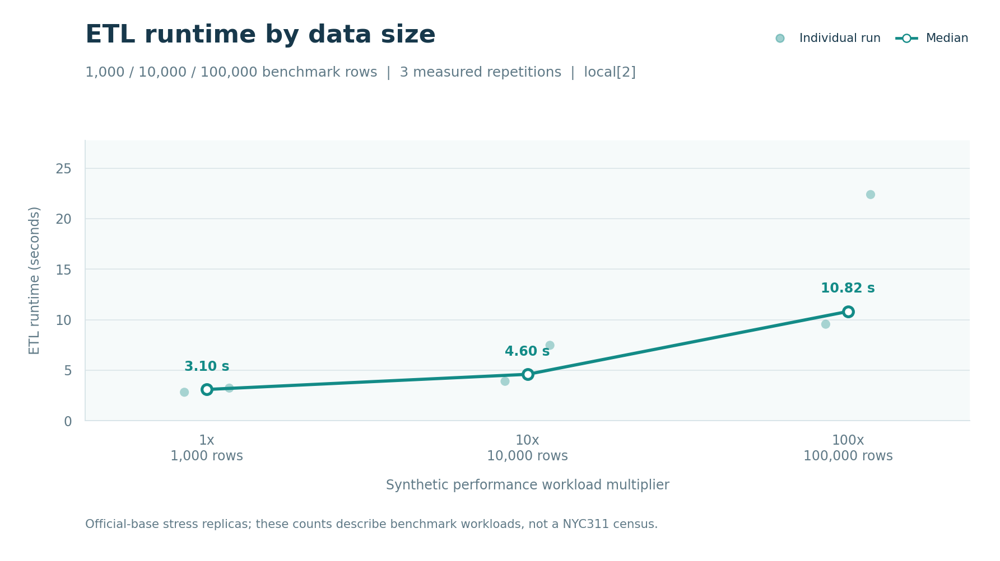
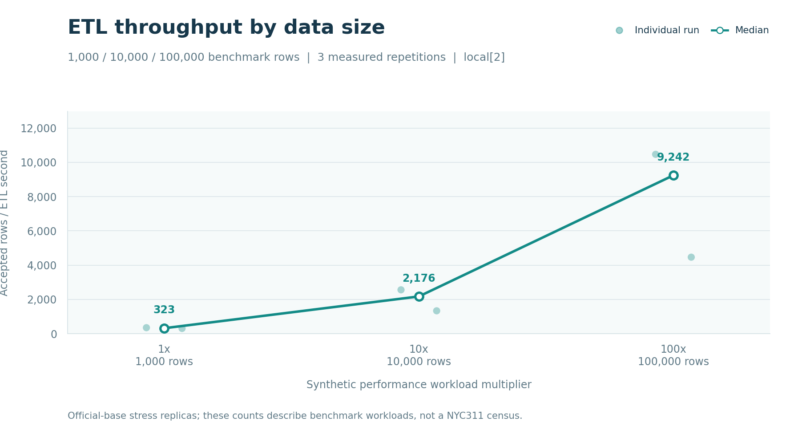
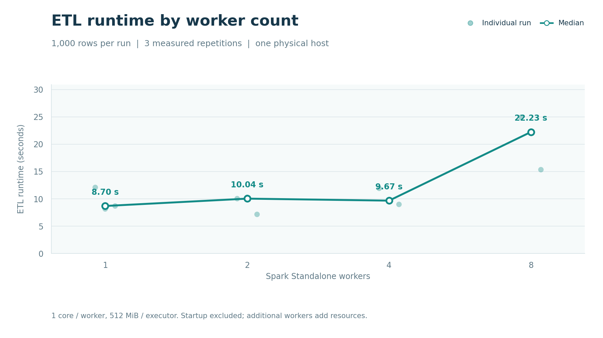
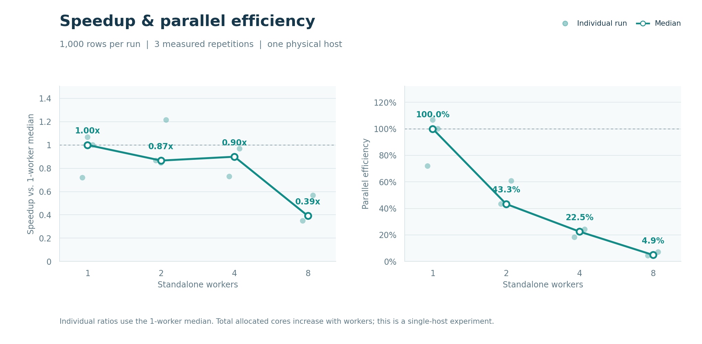
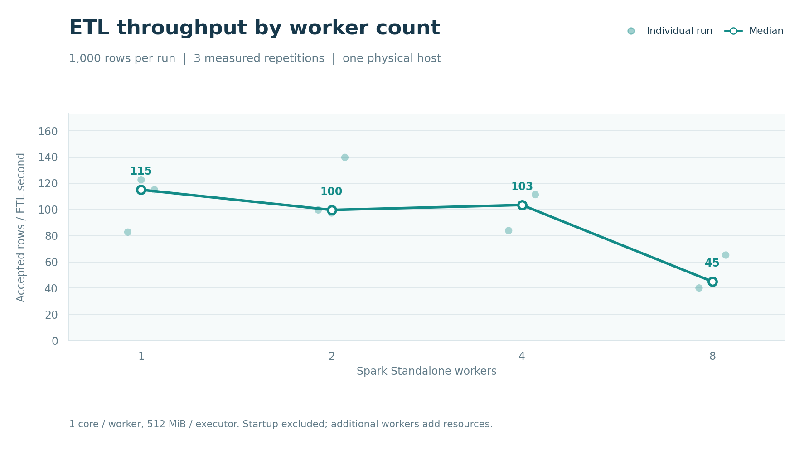

### Interactive exploration and interpretation

Overview, survival and demand/weather views share creation-year, inclusive local-date range/cutoff, agency, borough and complaint filters. Daily/weekly/monthly aggregation and moving averages support different questions. A timeline brush changes the analysis cohort; detail-chart pan/zoom and legend highlights change only the visual presentation. Linked counts, composition tables, KM estimates and explanatory cards are recomputed from the persisted official silver data. Exported series and interpretation text include the selected dates, category filters and fixed follow-up cutoff. Only downloaded years are selectable; the current pilot remains January–March 2025.

Dynamic interpretations describe sample arrivals and agency concentration. Previous-period changes require two fully covered, equal-length local calendars; low-count or zero baselines suppress percentage claims. Within-window comparisons use equal calendar blocks and are explicitly labelled. Unknown extraction days remain gaps, partial calendar buckets are identified, and annual/causal conclusions are not inferred. Interactive weather associations are unadjusted exploratory Spearman correlations for the selected cohort; they do not replace the saved heat-specific month-controlled analysis in section 7.

Saved Cox training/holdout metrics, the prediction model, streaming evidence, capacity calibration and benchmark records keep their own labelled scopes. Date/category filters do not retrain the model or recalibrate capacity scenarios. Backend examples from the real silver artifact are in [interactive_analytics_examples.json](../artifacts/metrics/interactive_analytics_examples.json):

```json
[
  {
    "selection": {
      "start_date": "2025-01-01",
      "end_date": "2025-03-31",
      "end_date_inclusive": true,
      "timezone": "America/New_York",
      "frequency": "daily",
      "agencies": null,
      "complaint_types": null,
      "boroughs": null
    },
    "selected_rows": 8813,
    "covered_days": 90,
    "censored_rows": 270
  },
  {
    "selection": {
      "start_date": "2025-02-01",
      "end_date": "2025-02-28",
      "end_date_inclusive": true,
      "timezone": "America/New_York",
      "frequency": "daily",
      "agencies": [
        "HPD"
      ],
      "complaint_types": null,
      "boroughs": [
        "BRONX"
      ]
    },
    "selected_rows": 253,
    "covered_days": 28,
    "censored_rows": 8
  },
  {
    "selection": {
      "start_date": "2025-01-01",
      "end_date": "2025-01-15",
      "end_date_inclusive": true,
      "timezone": "America/New_York",
      "frequency": "daily",
      "agencies": null,
      "complaint_types": null,
      "boroughs": null
    },
    "selected_rows": 1902,
    "covered_days": 15,
    "censored_rows": 46
  },
  {
    "selection": {
      "start_date": "2025-01-01",
      "end_date": "2025-03-31",
      "end_date_inclusive": true,
      "timezone": "America/New_York",
      "frequency": "daily",
      "agencies": [],
      "complaint_types": null,
      "boroughs": null
    },
    "selected_rows": 0,
    "covered_days": 90,
    "censored_rows": 0
  }
]
```

Control checks: [interactive_dashboard_app_test.json](../artifacts/metrics/interactive_dashboard_app_test.json), reproducible with `source scripts/env.sh && .venv/bin/python dashboard/verify_interactions.py`. Actual browser pointer/brush, export and responsive-layout evidence: [dashboard_interaction_qa.json](../artifacts/metrics/dashboard_interaction_qa.json). AppTest and browser checks are separate evidence; neither implies an unexecuted deployment.

## 10. Failures, limitations, ethics and reproducibility

Environment evidence: [environment.json](../artifacts/metrics/environment.json), [postgres_environment.json](../artifacts/metrics/postgres_environment.json). Initial sandbox DNS/socket restrictions and the original unsupported Java 18 were resolved using authorized host access and a project-local fixed Java 17 runtime. Docker startup initially used an older local demo port/password during concurrent setup; the final service uses the documented port 55432. Raw attempt logs remain local in `artifacts/logs`; benchmark failure records remain in tracked CSV/JSON. Remaining blockers and exact checks are in [IMPLEMENTATION_STATUS.md](../IMPLEMENTATION_STATUS.md).

```json
{
  "python": "3.11.18 (main, Oct 25 2026, 19:41:29) [Clang 16.0.0 (clang-1600.0.26.6)]",
  "platform": "macOS-14.6.1-arm64-arm-64bit",
  "machine": "arm64",
  "logical_cpu_count": 8,
  "ram_bytes": 17179869184,
  "disk_free_bytes": 196419395584,
  "java": {
    "status": "Passed",
    "returncode": 0,
    "output": "java version \"17.0.12\" 2024-07-16 LTS\nJava(TM) SE Runtime Environment (build 17.0.12+8-LTS-286)\nJava HotSpot(TM) 64-Bit Server VM (build 17.0.12+8-LTS-286, mixed mode, sharing)"
  },
  "docker": {
    "status": "Failed",
    "returncode": 1,
    "output": "CPU=0 RAM=0\nCannot connect to the Docker daemon at unix:///Users/qjfeng/.docker/run/docker.sock. Is the docker daemon running?"
  },
  "network": {
    "status": "Passed",
    "dataset": "311 Service Requests from 2020 to Present",
    "complaint_type_verified": true,
    "selected_field_names": [
      "unique_key",
      "created_date",
      "closed_date",
      "agency",
      "complaint_type",
      "borough"
    ]
  }
}
```

Pinned Python dependencies are in `requirements.lock`; source dates, seeds and thresholds are in `config/default.yaml`. Run `make setup`, `make db-up`, `make test`, `make smoke`, `make fetch-sample`, `make etl`, `make analyze`, `make stream-demo`, `make bench`, `make bench-workers`, `make report`. `make fetch-weather` is optional before `make analyze`; unavailable weather is explicitly recorded. See [README](../README.md) and [demo_script](demo_script.md). This existing environment has been exercised; a separate clean machine/container rebuild is reported only if actually executed. Do not publish personal address fields; output uses selected categories and borough-level aggregates. Model scores reflect observational administrative closure, not service quality or fairness.

Clean build evidence: [container_build.json](../artifacts/metrics/container_build.json). Fresh Linux container smoke, without host bind mounts: [container_smoke.json](../artifacts/metrics/container_smoke.json). The separate container uses the same project PostgreSQL service; it is not a second physical machine or the Docker Spark worker matrix.

Final pytest evidence [pytest.xml](../artifacts/metrics/pytest.xml):

```json
{
  "tests": 95.0,
  "failures": 0.0,
  "errors": 0.0,
  "skipped": 0.0,
  "time": 20.806,
  "status": "Passed"
}
```

Offline engineering evidence: [smoke.json](../artifacts/metrics/smoke.json). Synthetic smoke scores are not research outcomes.

## 11. Figures and conclusion

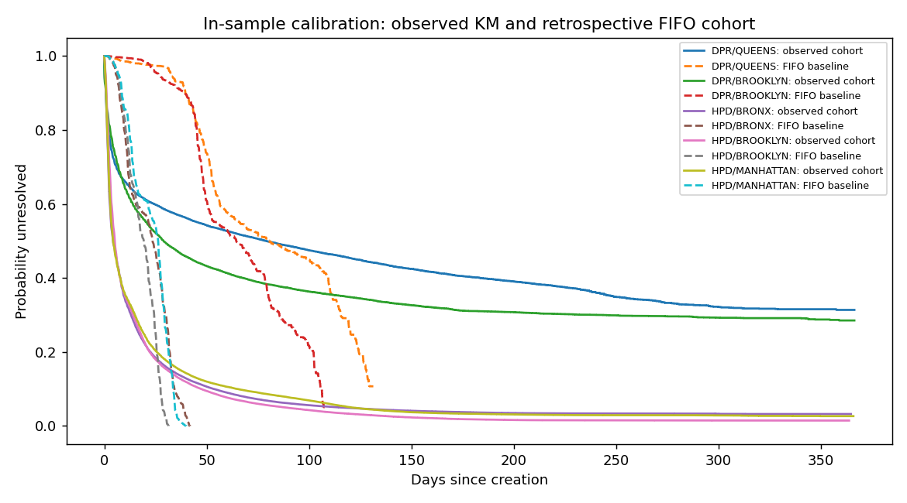
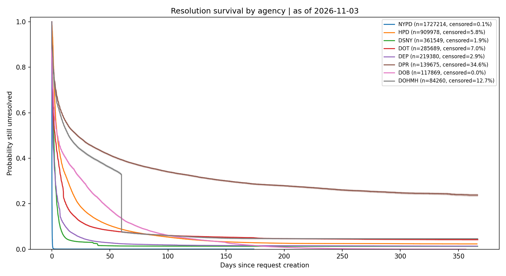
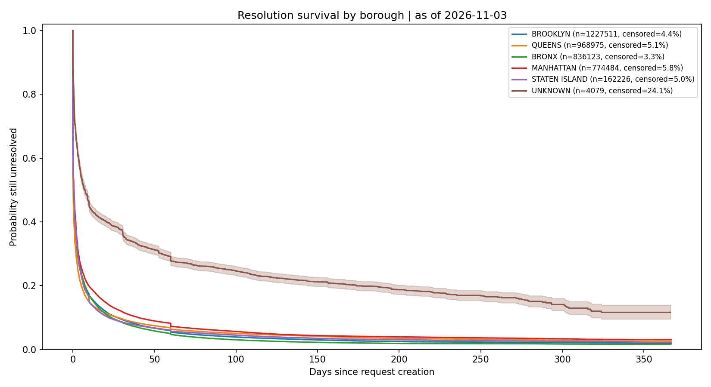
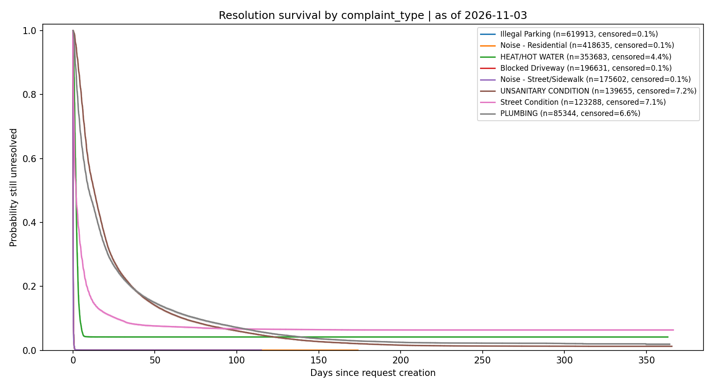
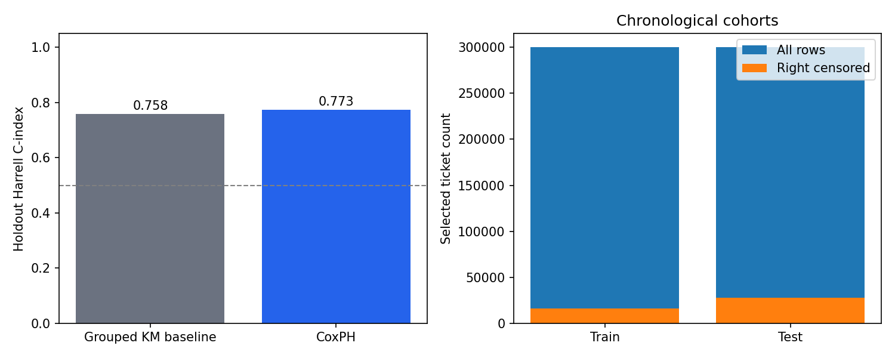
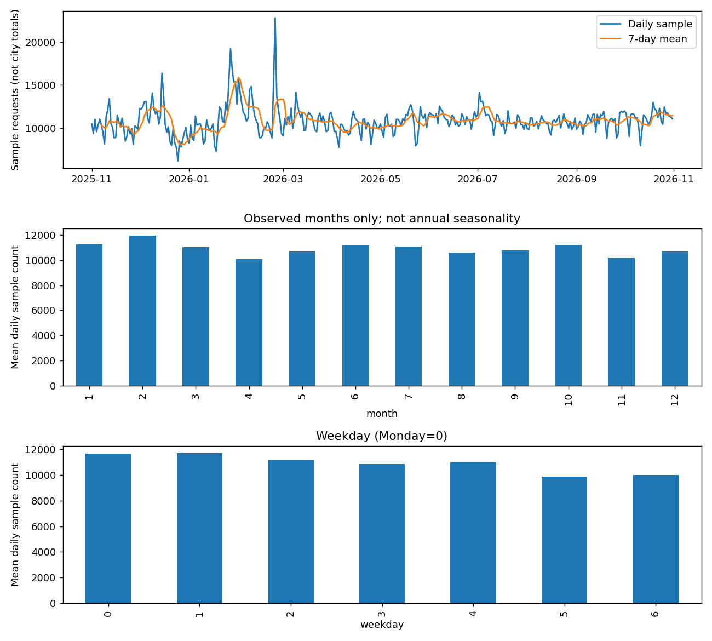
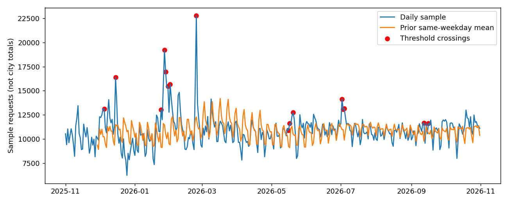
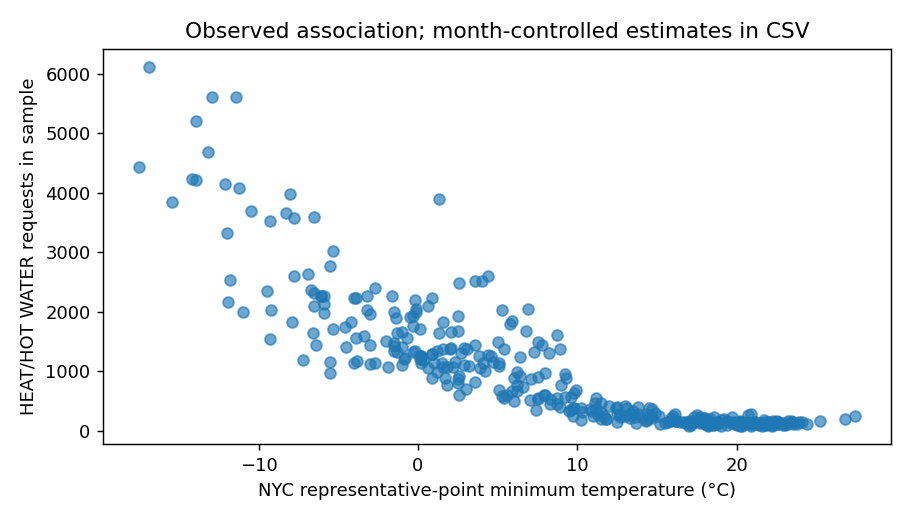

The auditable outputs above establish only what was run. Sample and single-host limitations constrain statistical and scaling conclusions. Capacity scenarios require operational validation before any resource decision.

## 12. References

1. [NYC Open Data, 311 Service Requests from 2020 to Present](https://data.cityofnewyork.us/d/erm2-nwe9).
2. [NYC Open Data, 311 Service Requests Updates](https://www.nyc.gov/opendata/news/all-news/311-Service-Requests-Updates).
3. [Socrata application tokens](https://dev.socrata.com/docs/app-tokens).
4. [Apache Spark 3.5 Structured Streaming documentation](https://spark.apache.org/docs/3.5.6/structured-streaming-programming-guide.html).
5. [lifelines KaplanMeierFitter](https://lifelines.readthedocs.io/en/latest/fitters/univariate/KaplanMeierFitter.html).
6. [lifelines CoxPHFitter](https://lifelines.readthedocs.io/en/latest/fitters/regression/CoxPHFitter.html).
7. [Open-Meteo Historical Weather API](https://open-meteo.com/en/docs/historical-weather-api).
